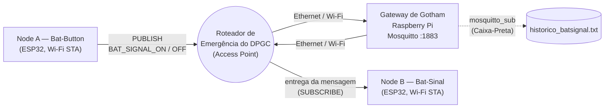

# Projeto 2 — O Servidor Central do DPGC (Gateway de Gotham)
**Disciplina:** Internet das Coisas (IoT) <br>
**Alunos:** Caio Lívio e Rafael Berg <br>
**Plataforma do Gateway:** Raspberry Pi (Raspberry Pi OS) <br>
**Nodes Táticos:** ESP32 com ESP-IDF v5.x
**Broker:** Mosquitto (MQTT)
> **Evidência em vídeo:** um vídeo do Raspberry Pi funcionando como broker MQTT, com os Nodes ligando e desligando o Bat-Sinal.
---
## 1. Objetivo
Evoluir a arquitetura do sistema de alerta de Gotham City (Projeto 1). Em vez de usar um broker público na internet, a comunicação entre os nós táticos passa por um **Gateway Local dedicado**, o Servidor de Comunicações do DPGC. Esse servidor roda em um Linux embarcado (aqui, um **Raspberry Pi**) e hospeda o broker **Mosquitto**. Assim, todo o tráfego de alertas fica dentro de uma rede privada, protegido de interferências externas (e do Charada).
O enunciado aceita tanto a BeagleBone Black quanto o Raspberry Pi. Este projeto foi feito no **Raspberry Pi**.
---
## 2. Arquitetura

| Componente | Papel | Conexão |
|---|---|---|
| Node A (Bat-Button) | Lê o push-button de emergência e **publica** o comando | Wi-Fi (STA) no roteador |
| Node B (Bat-Sinal) | **Assina** o tópico e liga/desliga o Bat-Sinal | Wi-Fi (STA) no roteador |
| Roteador de Emergência | Access Point da rede privada do DPGC | — |
| Gateway (Raspberry Pi) | Broker Mosquitto + log de auditoria | Ethernet ou Wi-Fi no roteador |
**Tópico de controle:** `gotham/dpgc/{nome_do_grupo}/batsignal`
**Payloads:** `BAT_SIGNAL_ON` e `BAT_SIGNAL_OFF`
---
## 3. Materiais Utilizados
### Hardware
- 02 × ESP32 (Node A e Node B)
- 01 × Raspberry Pi com Raspberry Pi OS
- 01 × Roteador Wi-Fi do laboratório
- 01 × Cabo Ethernet (opcional no Raspberry Pi, que também pode usar Wi-Fi)
- Periféricos do Projeto 1 (mesma montagem da atividade anterior)
### Software
- ESP-IDF v5.x (componente `esp-mqtt`)
- Raspberry Pi OS (Debian)
- Mosquitto e Mosquitto Clients (`mosquitto_pub` / `mosquitto_sub`)
---
## 4. Parte A — Configuração do Servidor Central (Raspberry Pi)
### 4.1 Instalação do broker
No terminal do Raspberry Pi (local ou via SSH):
```bash
sudo apt update
sudo apt upgrade -y
sudo apt install -y mosquitto mosquitto-clients
```
Para conferir a versão instalada:
```bash
mosquitto -h | head -n 1
```
### 4.2 Identificação na rede
Com o Raspberry Pi ligado ao roteador tático (cabo Ethernet ou Wi-Fi), descobre-se o IP local:
```bash
hostname -I
# ou, com mais detalhes por interface:
ip -4 addr show eth0     # se estiver no cabo
ip -4 addr show wlan0    # se estiver no Wi-Fi
```
Exemplo de saída:
```text
inet 192.168.0.X/24 brd 192.168.0.255 scope global dynamic eth0
```
O IP do Gateway é **`192.168.0.X`**. Esse é o endereço que vai na macro `MQTT_BROKER_URI` dos Nodes.
> **Dica:** como os ESP32 usam um IP fixo no código, vale criar uma **reserva DHCP** no roteador para o MAC do Raspberry Pi. Assim o IP do Gateway não muda depois de reinicializar.
### 4.3 Liberação dos canais de comunicação
A partir do Mosquitto 2.0, o broker só aceita conexões de `localhost` por padrão. Para os Nodes da cidade conseguirem se conectar pela rede, foi criado o arquivo `/etc/mosquitto/conf.d/gotham.conf`:
```bash
sudo nano /etc/mosquitto/conf.d/gotham.conf
```
Conteúdo:
```conf
# Servidor Central do DPGC — Gateway de Gotham
# Escuta na porta MQTT padrão em todas as interfaces de rede
listener 1883 0.0.0.0
# Rede privada do DPGC: conexões sem usuário/senha são permitidas
allow_anonymous true
```
O arquivo principal `/etc/mosquitto/mosquitto.conf` do Raspberry Pi OS já carrega tudo o que está em `conf.d/` (linha `include_dir /etc/mosquitto/conf.d`), então ele não precisou ser alterado.
Depois, reinicia-se o serviço para aplicar a configuração:
```bash
sudo systemctl restart mosquitto
```
Para confirmar que o broker está escutando na rede (e não só em `127.0.0.1`):
```bash
sudo ss -tlnp | grep 1883
# LISTEN 0 100 0.0.0.0:1883 0.0.0.0:* users:(("mosquitto",pid=...))
```
### 4.4 Persistência do serviço
Para o servidor do DPGC voltar sozinho depois de uma queda de energia ou reinicialização:
```bash
sudo systemctl enable mosquitto
sudo systemctl status mosquitto
```
O status deve mostrar `enabled` e `active (running)`. Para validar de verdade, basta reiniciar o Raspberry Pi (`sudo reboot`) e, quando ele voltar, rodar `systemctl status mosquitto` de novo.
### 4.5 Teste local do broker
Antes de envolver os ESP32, o broker foi testado com dois terminais no próprio Raspberry Pi.
**Terminal 1 (assinante):**
```bash
mosquitto_sub -h localhost -t "gotham/dpgc/#" -v
```
**Terminal 2 (publicador):**
```bash
mosquitto_pub -h localhost -t "gotham/dpgc/nome_do_grupo/batsignal" -m "BAT_SIGNAL_ON"
mosquitto_pub -h localhost -t "gotham/dpgc/nome_do_grupo/batsignal" -m "BAT_SIGNAL_OFF"
```
Saída esperada no Terminal 1:
```text
gotham/dpgc/nome_do_grupo/batsignal BAT_SIGNAL_ON
gotham/dpgc/nome_do_grupo/batsignal BAT_SIGNAL_OFF
```
Também dá para testar a partir de outro computador na mesma rede, trocando `localhost` pelo IP do Gateway (`-h 192.168.0.X`). Isso confirma que o `listener 1883 0.0.0.0` está funcionando.
---
## 5. Parte B — Atualização das Bat-Estações (ESP32)
As duas Bat-Estações continuam com as mesmas funções e a mesma ligação física do Projeto 1. Mudaram só duas coisas:
1. **Wi-Fi:** os Nodes agora se conectam, em modo Station (STA), ao SSID e à senha do **roteador físico** do laboratório.
2. **Broker:** o `MQTT_BROKER_URI` agora aponta para o **IP do Raspberry Pi**, e não mais para um broker público.
### 5.1 Reendereçamento de alertas (igual nos dois Nodes)
```c
/* IP do Gateway de Gotham (Raspberry Pi) */
#define MQTT_BROKER_URI  "mqtt://192.168.0.X:1883"
#define GROUP_NAME       "nome_do_grupo"
#define MQTT_TOPIC       "gotham/dpgc/" GROUP_NAME "/batsignal"
#define PAYLOAD_ON       "BAT_SIGNAL_ON"
#define PAYLOAD_OFF      "BAT_SIGNAL_OFF"
```
