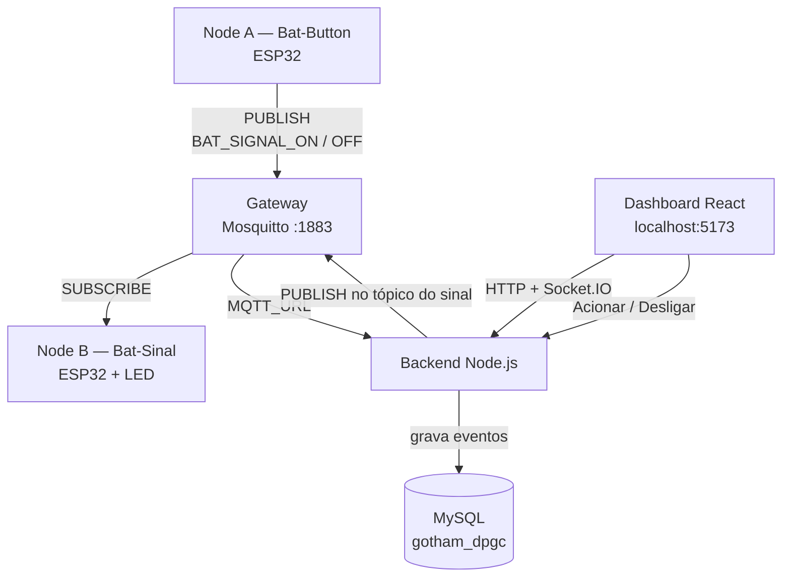

# Projeto 3 — Central de Inteligência de Gotham (Dashboard)
**Disciplina:** Internet das Coisas (IoT) <br>
**Alunos:** Caio Lívio e Rafael Berg <br>
**Objetivo:** dashboard web para monitorar e comandar o Bat-Sinal em tempo real <br>
**Repositório:** [https://github.com/RafaelBerg/IOT-Web](https://github.com/RafaelBerg/IOT-Web)

> O código-fonte (backend, frontend, schema MySQL e `.env`) está no repositório acima. Este arquivo é o relatório da atividade.

---

## 1. Objetivo

Fechar o ciclo dos Projetos 1 e 2 com uma **Central de Inteligência**: um painel web que vê o Bat-Sinal, guarda o histórico e consegue ligar ou desligar o LED à distância.

Até aqui o sistema já tinha:

- **Projeto 1** — Node A (botão) publica `BAT_SIGNAL_ON` / `BAT_SIGNAL_OFF`; Node B (LED) assina o tópico e acende o farol.
- **Projeto 2** — o broker passou a ser o Mosquitto no gateway local (Raspberry Pi), na rede privada do laboratório.

O Projeto 3 acrescenta a camada de software:

1. **Persistência** — cada mudança de estado e cada heartbeat entram no MySQL.
2. **Dashboard** — refletor com o estado atual, gráfico das últimas 24 horas e status dos nós.
3. **Comando reverso** — botões Acionar / Desligar no painel publicam no mesmo tópico MQTT; o Mosquitto entrega a mensagem ao Node B.

---

## 2. Arquitetura



| Camada | Papel |
|--------|--------|
| Node A / Node B | Mesmos ESP32 do Projeto 1, apontando para o broker do Projeto 2 |
| Mosquitto no gateway | Entrega o comando ao LED e ao backend |
| Backend Node.js | Assina MQTT, grava no MySQL, expõe API e Socket.IO |
| MySQL | Histórico de `signal_events` e `device_heartbeats` |
| Dashboard React | Estado ao vivo, gráfico 24 h e comando remoto |

**Tópico de comando:** `gotham/dpgc/{GROUP_NAME}/batsignal`  
**Tópico de status:** `gotham/dpgc/{GROUP_NAME}/status`  
**Payloads do sinal:** `BAT_SIGNAL_ON` e `BAT_SIGNAL_OFF` (o backend também aceita `1`/`0`, `ON`/`OFF` ou JSON com `state` / `value`)

---

## 3. O que o dashboard faz

- **Estado atual** — o refletor mostra se o Bat-Sinal está ligado ou desligado.
- **Últimas 24 horas** — gráfico da série temporal gravada em `signal_events`.
- **Nós online** — heartbeats a cada 30 s; um nó fica “sem sinal” se passar de 90 s sem heartbeat.
- **Comando remoto** — Acionar e Desligar no painel. Fluxo: React → backend → Mosquitto do gateway → Node B.
- **Retain no firmware** — a publicação do Node A vai com retain, para o painel receber o último estado ao reconectar.

Heartbeat (mesmo formato do Projeto 1):

```json
{"device":"bat_button","status":"ONLINE","uptime_s":120}
```

---

## 4. Persistência (MySQL)

Schema em [`sql/schema.sql`](https://github.com/RafaelBerg/IOT-Web/blob/main/sql/schema.sql) no repositório.

| Tabela | Conteúdo |
|--------|----------|
| `signal_events` | Cada `BAT_SIGNAL_ON` / `BAT_SIGNAL_OFF`, origem `mqtt` ou `dashboard`, horário em milissegundos |
| `device_heartbeats` | Heartbeats do tópico `status` (`bat_button`, `bat_sinal`, uptime) |

Nada no código aponta para um MySQL fixo. Host, usuário e senha entram só no `.env` do PC onde o sistema roda.

---

## 5. Como subir

Instruções completas: [README do IOT-Web](https://github.com/RafaelBerg/IOT-Web). Resumo:

1. Clonar [https://github.com/RafaelBerg/IOT-Web](https://github.com/RafaelBerg/IOT-Web).
2. Copiar `.env.example` para `.env` e preencher MySQL + `MQTT_URL` do gateway + `GROUP_NAME`.
3. Criar o database e rodar `sql/schema.sql`.
4. Subir backend e frontend:

```text
cd backend && npm install && npm run dev
cd frontend && npm install && npm run dev
```

5. Abrir `http://localhost:5173`.

---

## 6. Relação com os projetos anteriores

| Projeto | Entrega | Onde está |
|---------|---------|-----------|
| 1 — Bat-Sinal | Dois nós ESP32 (botão + LED) | [projeto_1](../projeto_1/README.md) |
| 2 — Gateway | Mosquitto no Raspberry Pi | [projeto_2/relatorio.md](../projeto_2/relatorio.md) |
| 3 — Dashboard | Painel web + MySQL + comando remoto | **[IOT-Web](https://github.com/RafaelBerg/IOT-Web)** |
